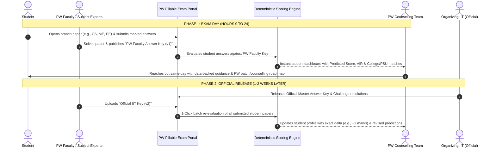

# Physics Wallah (PW) In-House GATE Rank, College & PSU Predictor
## Master System Blueprint & Phase-Wise Roadmap

---

## 1. Executive Summary & Cost Analysis

### Do you need paid subscriptions, paid APIs, or expensive AI?
**No. The entire system can be built 100% free with zero paid API dependencies and zero monthly software subscriptions.**

* **Data Sourcing (Free):** All official cutoffs for CCMT (NITs/IIITs), COAP (IITs), and public sector undertakings (PSUs) are public record.
* **Response Sheet Evaluation (Free):** Student response parsing uses open-source HTML/DOM parsers. No OCR or paid parser APIs required.
* **Hosting & Database (Free / Low Cost):** Can run entirely on in-house PW infrastructure, local machines, or free/open-source stacks (PostgreSQL/SQLite, Python FastAPI, React/Streamlit).
* **Where AI Fits (Optional & Free):**
  * **Rule 1 (Golden Rule):** **Never use AI/LLMs for score calculation, normalization, or cutoff matching.** Calculations must be **100% deterministic, mathematical, and unbreachable**.
  * **Rule 2 (Value-Add AI):** AI can be used optionally for generating qualitative counsellor talking points (e.g., *"Student lost 14 marks in negative marking. Strong in Algorithms, weak in OS. High chance for NIT Trichy CSE; advise applying to IOCL"*). This can be powered by free-tier APIs or local open-weights models (Ollama/Llama 3).

---

## 2. The Real-World Exam-Day Workflow (The Two-Phase Lifecycle)

This system is specifically architected for the high-stakes **Exam Day (Day 0)** window when student emotions, search traffic, and counselling intent are at their absolute peak:

---

## 3. Core Architectural Components

```mermaid
flowchart TD
    subgraph Ingestion ["1. Student Input & Response Capture"]
        A1["Interactive Web Exam Form<br/>(MCQ / MSQ / NAT)"]
        A2["TCS iON Response Sheet URL<br/>(Auto Scraper)"]
        A3["Counsellor Manual Entry<br/>(Fast Walk-in Mode)"]
    end

    subgraph Evaluation ["2. Deterministic Scoring Engine"]
        B1["Master Question Paper & Answer Key Store"]
        B2["Scoring Rules Engine<br/>(+1/-0.33, +2/-0.66, MSQ/NAT zero neg)"]
        B3["Raw Score & Sectional Breakdown<br/>(Aptitude vs Core)"]
    end

    subgraph Normalization ["3. GATE Statistical Engine"]
        C1["Session Statistics Accumulator<br/>(Mean, StdDev, Top 0.1%)"]
        C2["Official Multi-Session Normalization Formula"]
        C3["GATE Score (out of 1000) & AIR Predictor"]
    end

    subgraph PredictionEngine ["4. Three-Tier Prediction Engine"]
        D1["IITs / IISc Engine<br/>(COAP Round 1-5 + Additional Rounds)"]
        D2["NITs / IIITs / CFTIs Engine<br/>(CCMT Rounds 1-3 + Special + NSR)"]
        D3["PSU Recruitment Engine<br/>(IOCL, ONGC, NTPC, HPCL, BARC, etc.)"]
    end

    subgraph OpsPortal ["5. PW Counsellor Operations Dashboard"]
        E1["Student Lookup & CRM Profile"]
        E2["Categorized Choice Lists<br/>(Ambitious / Target / Safe)"]
        E3["1-Click PW Branded PDF / WhatsApp Report"]
    end

    Ingestion --> Evaluation
    Evaluation --> Normalization
    Normalization --> PredictionEngine
    PredictionEngine --> OpsPortal
```

---

## 4. Deep-Dive: Core Subsystems

### Subsystem 1: The Exam & Response Capture Engine

The tool handles the exact operational reality of GATE exam season:
1. **Exam Day Fillable Web Paper (Hour 0 to 24):**
   * As soon as an exam shift ends, students land on the PW portal.
   * Student selects their branch (e.g., Computer Science, Mechanical, Civil, Electrical).
   * They see an interactive 65-question fillable form (matching the GATE pattern: General Aptitude 1-10, Core 11-65).
   * Supports all 3 question mechanics:
     * **MCQ (Single Choice):** Options A, B, C, D radio select.
     * **MSQ (Multi Select):** Options A, B, C, D multi-select checkboxes.
     * **NAT (Numerical Answer):** Clean virtual numeric input box for numerical values.
   * Student clicks "Submit Paper & Get My Predicted Colleges".
2. **Versioned Answer Key Architecture (Faculty vs Official):**
   * **Stage 1 (Exam Day):** PW Subject Experts/Faculty live-solve the paper and enter the **PW Faculty Key (Version 1)**. The moment a student submits, their paper is immediately graded against this faculty key.
   * **Stage 2 (Key Revision):** If faculty amends any question based on internal consensus, the system flags it as `Version 1.1` and re-runs grading instantly.
   * **Stage 3 (Official IIT Key Release):** 1-2 weeks later, the organizing IIT publishes the official answer key. The admin uploads the **Official Master Key (Version 2)**. The engine runs a 1-click batch re-evaluation across all student records, showing the exact score delta (e.g., *"+3 marks gained after official key"*).
3. **Official Response Sheet (TCS iON) Mode (Post-Release Fallback):**
   * For students who did not fill out the exam-day form, they can simply paste their official response sheet URL once released. The scraper auto-populates the answers and runs the exact same grading pipeline.
   * Students can submit responses *before* the answer key is published.
   * As soon as PW faculty releases the provisional key or IIT publishes the official master key, an automated batch job evaluates thousands of stored responses in under 10 seconds.

### Subsystem 2: GATE Evaluation & Normalization Engine

#### 1. Exact Marking Scheme
* **1-Mark MCQ:** $+1.0$ for correct, $-0.333$ for incorrect.
* **2-Mark MCQ:** $+2.0$ for correct, $-0.667$ for incorrect.
* **1-Mark MSQ:** $+1.0$ if and only if exact option set matches; $0$ otherwise (no negative).
* **2-Mark MSQ:** $+2.0$ if and only if exact option set matches; $0$ otherwise (no negative).
* **1-Mark NAT:** $+1.0$ if $Value_{min} \le Answer \le Value_{max}$; $0$ otherwise.
* **2-Mark NAT:** $+2.0$ if $Value_{min} \le Answer \le Value_{max}$; $0$ otherwise.

#### 2. Multi-Session Normalization (For CS, ME, CE, EE)
$$\hat{M}_{ij} = \frac{\bar{M}_t^g - M_q^g}{\bar{M}_{ti} - M_{iq}} (M_{ij} - M_{iq}) + M_q^g$$

* Using PW's internal student submissions per shift, the system dynamically calculates $\bar{M}_{ti}$ (shift top 0.1% mean) and $M_{iq}$ (shift mean + std dev).
* Calculates Normalized Marks $\hat{M}$ and maps to **GATE Score ($S$)** out of 1000:
$$S = S_q + (S_t - S_q) \frac{\hat{M} - M_q}{\bar{M}_t - M_q}$$
*(Where $S_q = 350$ typically for qualifying marks $M_q$, and $S_t = 900$ for top 0.1% marks $\bar{M}_t$).*

---

### Subsystem 3: Three-Tier Prediction Engine

#### Tier A: IITs & IISc (COAP Cutoff Engine)
* Predicts across 23 IITs and IISc Bangalore.
* Differentiates between:
  * **Direct Admission Offers** (high GATE scores, no interview).
  * **Written Test / Interview Shortlist Calls** (e.g., MS by Research, IIT Madras/IIT Delhi interdisciplinary programs).
* Supports **Interdisciplinary Specializations** (e.g., a Mechanical student eligible for Materials Science, Robotics, or Data Science).

#### Tier B: NITs, IIITs & CFTIs (CCMT Cutoff Engine)
* Comprehensive historical database (last 3-5 years) of Opening and Closing GATE scores.
* Models round-by-round movement:
  * **Regular Rounds (Rounds 1, 2, 3)**
  * **Special Rounds (SR1, SR2)**
  * **National Spot Round (NSR)**
* Full reservation category support: **General, EWS, OBC-NCL, SC, ST, PwD**.

#### Tier C: PSU Recruitment Predictor
* Covers major PSUs recruiting through GATE: **IOCL, ONGC, NTPC, BHEL, GAIL, HPCL, BPCL, PGCIL, BARC, DRDO, NPCIL, BIS, CIL**.
* Predicts probability of:
  * **Interview Shortlist Call** (based on historical shortlisting GATE score / rank).
  * **Final Selection Threshold** (factoring in 70-85% GATE score weightage + 15-30% GD/GT/Interview weightage).

---

### Subsystem 4: Counsellor Operations Dashboard

Built specifically for high-velocity internal counseling operations:
1. **Instant Student Lookup:** Search by Student ID, Phone Number, Email, or Candidate Name.
2. **Performance Diagnostic:**
   * Raw Marks, Normalized Marks, GATE Score, Estimated AIR range.
   * Section breakdown: General Aptitude vs Engineering Mathematics vs Core Technical.
   * "Marks Lost to Negatives" — a powerful counseling metric showing how many marks were surrendered to negative marking.
3. **Choice-Filling Recommendation Matrix:**
   * **Ambitious (Dream):** Cutoff is 15-40 score points higher than student's score (spot round / interview conversion chances).
   * **Target (Realistic):** Student's score falls within $\pm 15$ points of historical closing score.
   * **Safe (Backup):** Historical closing score is at least 30+ points below student's score ($>85\%$ admission certainty).
4. **1-Click Shareable PW Report:**
   * Clean PDF or formatted WhatsApp message summarizing the student's best options, ready to send before hanging up the call.

---

## 4. Phase-Wise Development Plan

| Phase | Duration | Core Deliverables | Success Criteria |
| :--- | :--- | :--- | :--- |
| **Phase 1: Foundations & Core Mathematical Engine** | Week 1–2 | • Database Schema (PostgreSQL/SQLite) • GATE Evaluation Engine (MCQ, MSQ, NAT) • Multi-session Normalization & Score Algorithm • Unit tests covering all edge-case markings | 100% test coverage on scoring edge cases (negative marks, NAT ranges, multi-select MSQs). |
| **Phase 2: Historical Cutoffs & Prediction Core** | Week 3–4 | • Ingestion pipelines for CCMT (NITs/IIITs) 3-5 yr data • Ingestion of COAP (IITs) cutoff tables • Ingestion of PSU shortlisting cutoff scores • 3-Tier Categorization (Ambitious / Target / Safe) | Accuracy verified against previous year actual allotments with zero missing category filters. |
| **Phase 3: Student Response Capture & Web Forms** | Week 5–6 | • Online Sample Paper / Response Submission Form • TCS iON Response Sheet URL Scraper • Decoupled Answer Key Management Portal • Instant Batch Re-evaluation worker | 1,000 student response sheets evaluated in $<5$ seconds upon answer key update. |
| **Phase 4: Counsellor Operations Portal** | Week 7–8 | • Fast Counsellor Search & Student Profile UI • Interactive Preference Builder (Branch & Location filters) • 1-Click PDF Report Generator (PW Branded) • WhatsApp-ready summary generator | Counsellor can pull up student and generate custom list in $< 30$ seconds on a live call. |
| **Phase 5: Pilot, Stress Testing & Deployment** | Week 9 | • Load testing with simulated 50k student submissions • Counsellor team training & feedback loop • Production deployment on PW internal server/cloud | Zero downtime, instant search, zero math hallucinations. |

---

## 5. Unbreakable System Principles (Safeguards)

1. **Zero Math Hallucination:** No prediction is generated by an LLM prompt. All predictions are strict SQL queries and mathematical comparisons against verified historical cutoff records.
2. **Immutable Audit Trail:** When a student's paper is evaluated, both the raw submitted payload and the evaluated score breakdown are timestamped and preserved.
3. **Graceful Handling of Answer Key Revisions:** GATE answer keys frequently change after objections (e.g., Marks to All (MTA), multiple correct keys for NAT). The system can re-run all student evaluations with a single click without data corruption.
4. **Zero-Latency Offline Capability:** The core matching engine can run entirely offline or in a lightweight SQLite container without depending on external web services.
