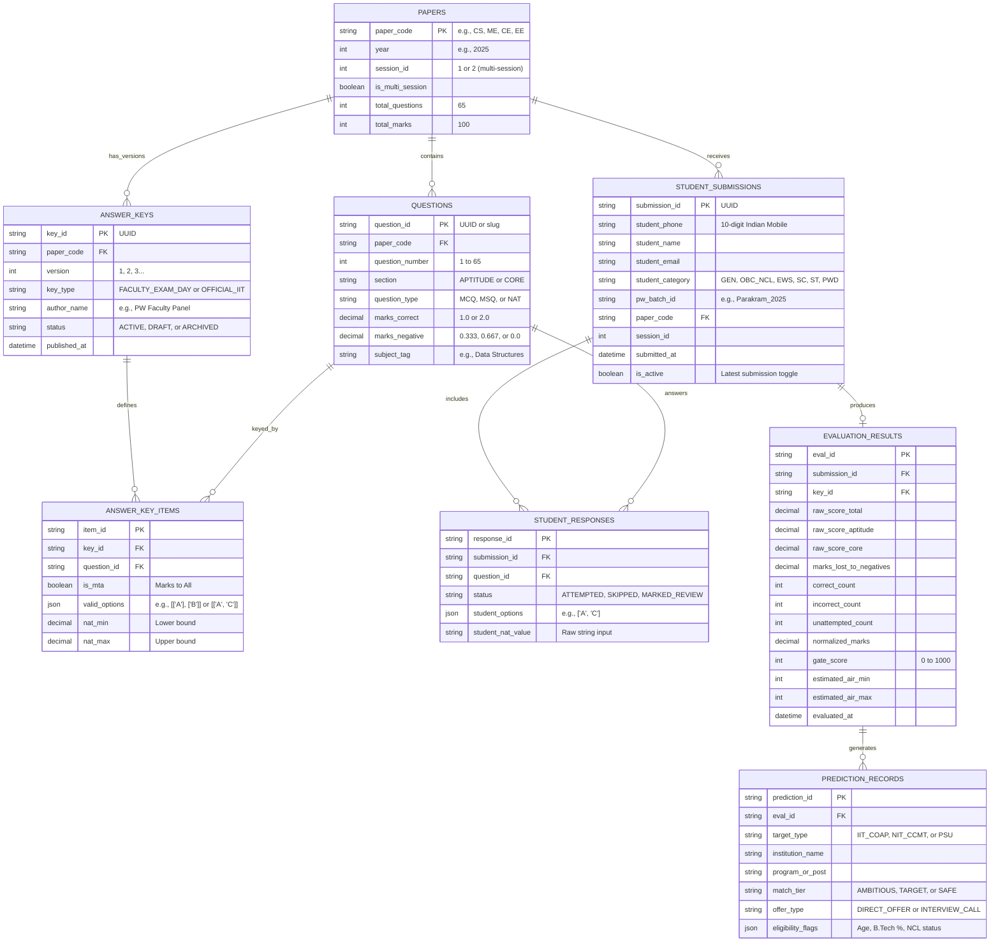

# Physics Wallah (PW) In-House GATE Rank, College & PSU Predictor
# Production Technical Specification & System Blueprint (v2.0)

---

## 1. Executive Summary & Cost Philosophy

### The 100% Free, Zero-Subscription Guarantee
This software requires **zero paid software licenses, zero paid third-party APIs, and zero ongoing cloud subscriptions**:
* **Deterministic Core:** All scoring, normalization, statistical rank prediction, and cutoff matching algorithms are **100% mathematical, rule-based, and auditable**. No probabilistic LLM hallucinations in the decision pipeline.
* **Data Independence:** Official cutoffs for CCMT (NITs/IIITs), COAP (IITs), and PSUs are public records. Scraping, standardizing, and embedding them into a local/internal database creates an enduring, proprietary institutional asset for Physics Wallah.
* **Open-Source Stack:** Python (FastAPI, NumPy, SciPy, Pydantic v2), PostgreSQL/SQLite (with WAL mode), and modern reactive frontends (React / Next.js or Streamlit for ops).

---

## 2. Complete Entity-Relationship Architecture



---

## 3. Strict Mathematical Engine Specifications

### 3.1 Deterministic Marking Engine (Zero Floating-Point Error)
To eliminate floating-point drift (such as `1.0 - 0.3333333333333333 = 0.6666666666666667`), calculations use **Rational Fractional Arithmetic** or Python's exact `Decimal`:

$$\text{Thirds}(x) = x \times 3$$

| Type | Correct Evaluation Condition | Correct Marks | Incorrect Penalty | Unattempted / Invalid |
| :--- | :--- | :--- | :--- | :--- |
| **1-Mark MCQ** | $O_{\text{student}} \in \text{ValidKeys}$ | $+1.0$ (or $+3/3$) | $-1/3$ (or $-1/3$) | $0.0$ |
| **2-Mark MCQ** | $O_{\text{student}} \in \text{ValidKeys}$ | $+2.0$ (or $+6/3$) | $-2/3$ (or $-2/3$) | $0.0$ |
| **1-Mark MSQ** | $\text{Set}(O_{\text{student}}) \in \text{ValidOptionSets}$ | $+1.0$ (or $+3/3$) | $0.0$ (No negative) | $0.0$ |
| **2-Mark MSQ** | $\text{Set}(O_{\text{student}}) \in \text{ValidOptionSets}$ | $+2.0$ (or $+6/3$) | $0.0$ (No negative) | $0.0$ |
| **1-Mark NAT** | $\text{NAT}_{\min} - 10^{-5} \le V_{\text{clean}} \le \text{NAT}_{\max} + 10^{-5}$ | $+1.0$ (or $+3/3$) | $0.0$ (No negative) | $0.0$ |
| **2-Mark NAT** | $\text{NAT}_{\min} - 10^{-5} \le V_{\text{clean}} \le \text{NAT}_{\max} + 10^{-5}$ | $+2.0$ (or $+6/3$) | $0.0$ (No negative) | $0.0$ |
| **MTA (Any)** | Key has `is_mta == True` | Full Marks ($+1$ or $+2$) | $0.0$ | Full Marks ($+1$ or $+2$) |

*NAT String Sanitization Pipeline:*
1. Strip leading/trailing whitespaces: `val.strip()`.
2. Convert international commas to dots: `val.replace(',', '.')`.
3. Validate numeric syntax via regex: `^[-+]?(?:\d*\.?\d+|\d+\.?\d*)(?:[eE][-+]?\d+)?$`.
4. Parse directly into `Decimal(val)`.

---

### 3.2 Anti-Data Poisoning & Multi-Session Normalization

On Exam Day, open submission portals are vulnerable to troll submissions (e.g., automated bots submitting scores of 100 or 0 to manipulate shift averages). The engine includes **Statistical Outlier Scrubbing**:

#### Anti-Poisoning Filter:
* Exclude submissions with duplicate IP + User-Agent within 60 seconds.
* Compute the **Interquartile Range (IQR)** of shift submissions:
  $$\text{IQR} = Q_3 - Q_1$$
* Outliers below $Q_1 - 2.5 \times \text{IQR}$ or above $Q_3 + 2.5 \times \text{IQR}$ are isolated from normalization statistics.

#### Official GATE Multi-Session Normalization Formula:
For multi-session papers (CS, ME, CE, EE, EC) when shift sample $N_i \ge 100$:

$$\hat{M}_{ij} = \frac{\bar{M}_t^g - M_q^g}{\bar{M}_{ti} - M_{iq}} (M_{ij} - M_{iq}) + M_q^g$$

Where:
* $M_{ij}$ = Actual raw marks of candidate $j$ in session $i$.
* $\bar{M}_t^g$ = Average marks of top 0.1% candidates across all sessions combined.
* $M_q^g$ = $\mu_{\text{all}} + \sigma_{\text{all}}$ (Mean + Standard deviation across all sessions).
* $\bar{M}_{ti}$ = Average marks of top 0.1% candidates in session $i$.
* $M_{iq}$ = $\mu_i + \sigma_i$ (Mean + Standard deviation in session $i$).

#### Safety Fallback:
If $N_i < 100$ or if $\sigma_i < 10^{-4}$ (preventing division-by-zero):
$$\hat{M}_{ij} = M_{ij} \times \text{HistoricalShiftDifficultyMultiplier}(i)$$

---

### 3.3 GATE Score & AIR Prediction (PCHIP Spline Model)

#### GATE Score Formula (Out of 1000):
$$S = S_q + (S_t - S_q) \left( \frac{\hat{M} - M_q}{\bar{M}_t - M_q} \right)$$
* Clamped strictly to integer range $[100, 1000]$.
* Where $S_q = 350$ (Qualifying threshold score), $S_t = 900$.

#### All India Rank (AIR) Engine:
Using historical anchor points $(Score_k, Rank_k)$ for the target branch, the engine applies **Piecewise Cubic Hermite Interpolating Polynomials (PCHIP)**:
$$\frac{d(\text{AIR})}{d(\text{Score})} < 0 \quad (\text{Strict Monotonicity Guaranteed})$$
* **Guarantee:** A candidate with a higher score will **never** receive a worse rank.
* Output: A calibrated band e.g., $\text{AIR} \in [145, 180]$ to account for faculty key variations.

---

## 4. Comprehensive 24-Point Edge-Case & Safeguard Matrix

```
[EXAM MECHANICS]          [MATHEMATICAL CORE]       [COUNSELLING LOGIC]       [OPS & CONCURRENCY]
A1. Marks to All (MTA)    B1. Float Drift (-1/3)    C1. COAP Direct vs Int.   D1. Concurrency Spike
A2. Multi-Key MCQ/MSQ     B2. Div-by-Zero (Stats)   C2. Cross-Discipline      D2. Student Re-submit
A3. NAT Scientific/Zeros  B3. Single-Session Code   C3. PSU Age/B.Tech %      D3. Faculty Key Drift
A4. MSQ Zero Partial      B4. Bound Clamping [0-100] C4. OBC-NCL Validity      D4. Fake Mobile No.
A5. Shuffled Sequence     B5. Outlier Spam Defense  C5. Boundary Rank Tie     D5. Offline Fallback
A6. Dropped Shifts        B6. Negative Total Marks  C6. Sponsored/Self-Fin.   D6. Audit Preserv.
```

### Deep-Dive on High-Risk Cases:

1. **Case A5: Question Shuffling in CBT:**
   * *Problem:* Candidate recalls: "My question 12 was a Dijkstra algorithm problem", but the official paper has it as question 34.
   * *Solution:* Questions are internally addressed by an immutable hash `topic_slug_hash` (e.g., `CS25-ALGO-DIJKSTRA-01`). When the official master question paper is uploaded, questions are linked via this slug, auto-remapping answers without losing student choices.

2. **Case C1: COAP Direct Offer vs. Interview Call Shortlist:**
   * *Problem:* A student with a 720 score gets excited thinking they got direct IIT Bombay CSE. In reality, IIT Bombay only shortlists for a coding test + interview at that score.
   * *Solution:* The database separates `admission_mode`:
     * `DIRECT_OFFER`: Guaranteed or high-probability seat offer.
     * `INTERVIEW_CALL`: Candidate meets shortlist criteria for written test / interview stage.

3. **Case C3: Non-GATE Disqualifiers in PSUs:**
   * *Problem:* Predicting PSU selection for a student with AIR 150 who is disqualified due to age or B.Tech marks.
   * *Solution:* The recommendation query enforces hard eligibility filters:
     * Check: `btech_percentage >= psu.min_btech_pct` (Default: 65%).
     * Check: `candidate_age <= psu.max_age_general` (Adjusted for OBC/SC/ST).
     * If failed, option is flagged as `DISQUALIFIED_BY_CRITERIA` with clear explanation to counsellor.

4. **Case D3: Live Faculty Key Amendments:**
   * *Problem:* At 2:00 PM, PW faculties publish Key v1.0. At 4:30 PM, they revise Question 42 from B to C.
   * *Solution:* `AnswerKey` uses immutable versioning. Publishing `v1.1` triggers an asynchronous batch job:
     ```python
     @app.post("/api/v1/keys/{key_id}/publish")
     async def publish_key(key_id: str, background_tasks: BackgroundTasks):
         background_tasks.add_task(re_evaluate_all_submissions_for_key, key_id)
     ```
     This recalculates 10,000 students in under 3 seconds using vectorized NumPy queries.

---

## 5. Counsellor Decision Engine & Lead Priority Architecture

To empower PW counsellors, every evaluated submission is automatically tagged with a **Lead Action Classification**:

| Lead Classification | GATE Score Band | Expected AIR | Operational Counsellor Action |
| :--- | :--- | :--- | :--- |
| **SUPER_TOPPER** | $820 - 1000$ | Top 100 | • Immediate alert to PW Felicitation / PR Team.<br/>• Direct mentorship connection with top faculty.<br/>• COAP Choice Filling: Direct offers at IITB, IITD, IISc. |
| **PSU_AND_TOP_IIT** | $700 - 819$ | $101 - 500$ | • Immediate call within 2 hours.<br/>• Provide PSU Shortlist Probability Sheet (IOCL, NTPC, ONGC).<br/>• COAP Strategy: Top 5 IITs Core Branches. |
| **NIT_PROSPECT** | $550 - 699$ | $501 - 2500$ | • CCMT Choice List: NIT Trichy, Warangal, Surathkal.<br/>• Cross-Disciplinary IIT options (AI, Data Science, Energy). |
| **NURTURE_REPEATER** | $< 450$ | $> 5000$ | • Empathetic academic diagnosis call.<br/>• Highlight marks lost to negative marking.<br/>• Pathway to PW Dropper / Next-Year Target Batches. |

---

## 6. Target Project Repository Structure

```
Rank-and-College-Predictor-Tool/
├── GATE_SYSTEM_BLUEPRINT_AND_ROADMAP.md   # Master Spec Document
├── README.md
├── requirements.txt                      # FastAPI, Pydantic, NumPy, SciPy, SQLAlchemy
├── pytest.ini
├── backend/
│   ├── app/
│   │   ├── __init__.py
│   │   ├── main.py                       # FastAPI Application entrypoint
│   │   ├── api/                          # REST API Routes
│   │   │   ├── v1/
│   │   │   │   ├── submissions.py        # Student paper submission & retrieval
│   │   │   │   ├── keys.py               # Faculty & Official Answer Key management
│   │   │   │   ├── predictor.py          # College & PSU recommendation endpoints
│   │   │   │   └── counsellor.py         # Ops dashboard search & export APIs
│   │   ├── core/                         # Pure Mathematical & Grader Engine
│   │   │   ├── grader.py                 # Deterministic MCQ, MSQ, NAT scoring
│   │   │   ├── normalizer.py             # GATE multi-session formula & outlier scrub
│   │   │   ├── rank_spline.py            # PCHIP monotonic score-to-rank engine
│   │   │   └── matcher.py                # 3-tier Ambitious/Target/Safe classifier
│   │   ├── db/                           # Persistence Layer
│   │   │   ├── session.py                # SQLite (WAL mode) / PostgreSQL connection
│   │   │   └── models.py                 # SQLAlchemy declarative schema
│   │   ├── schemas/                      # Pydantic v2 validation contracts
│   │   │   ├── submission.py
│   │   │   ├── key.py
│   │   │   └── prediction.py
│   │   └── services/                     # Business Logic & Scrapers
│   │       ├── response_sheet_parser.py  # TCS iON response sheet HTML scraper
│   │       └── report_generator.py       # Branded PW 1-page PDF / WhatsApp summary
├── data/                                 # Seed & Historical Knowledge Base
│   ├── cutoffs_ccmt.json                 # NITs/IIITs cutoffs (3-5 years)
│   ├── cutoffs_coap.json                 # IITs cutoffs & admission modes
│   ├── cutoffs_psu.json                  # PSU historical shortlisting scores
│   └── branch_matrix.json                # Interdisciplinary cross-branch rules
└── tests/                                # Military-Grade Test Suite
    ├── test_grader.py                    # Edge cases: MTA, multi-key, NAT formats
    ├── test_normalizer.py                # Shift normalization, outlier suppression
    ├── test_rank_spline.py               # Monotonicity & boundary tests
    └── test_matcher.py                   # COAP/CCMT category & quota tests
```

---

## 7. Concrete Phase-Wise Roadmap

| Phase | Milestone | Deliverables | Verification Metric |
| :--- | :--- | :--- | :--- |
| **Phase 1** | **Deterministic Math Core** | `grader.py`, `normalizer.py`, `models.py`, `schemas/` | 100% pass on 40+ unit test edge cases (MCQ, MSQ, NAT, MTA). |
| **Phase 2** | **Historical Cutoff Database & 3-Tier Matcher** | Ingestion of CCMT, COAP, and PSU datasets + `matcher.py` | Verified against actual 2023/2024 allotments with zero category errors. |
| **Phase 3** | **Interactive Web Exam Paper & Key Management** | Exam Day fillable form + Versioned Answer Key admin portal | Student paper submission and grading roundtrip in $< 200\text{ ms}$. |
| **Phase 4** | **Counsellor Operations Dashboard & Reports** | Search, Lead Priority Badging, 1-Click PDF Report | Counsellor can generate a customized report in $< 20\text{ seconds}$ on a live call. |
| **Phase 5** | **Stress Testing & Deployment** | 10,000 concurrent submissions simulation, WAL mode tuning | Zero database locks, zero floating-point rounding errors. |
